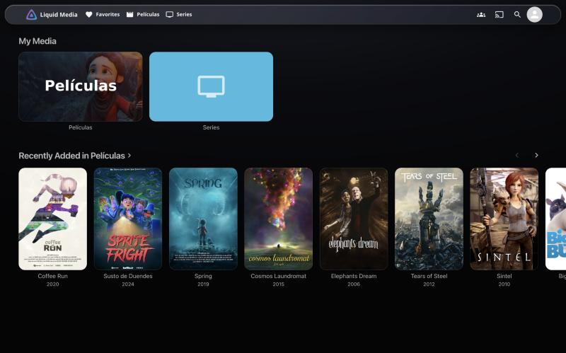
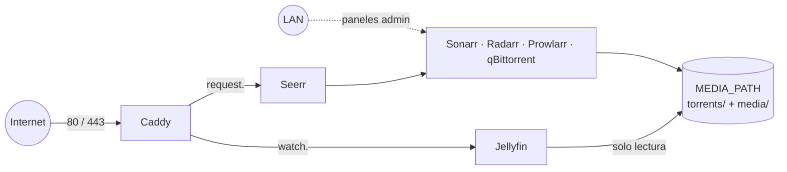
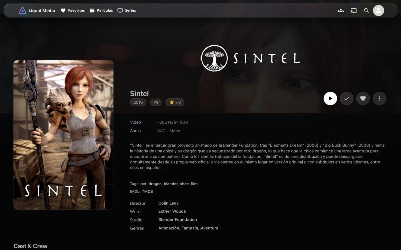
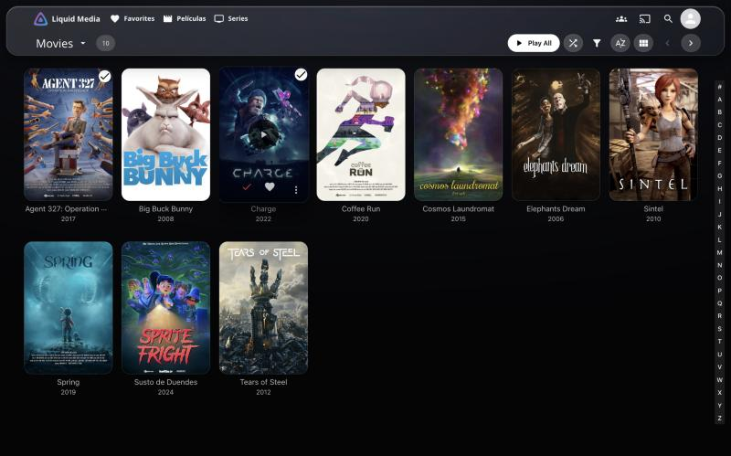

# Liquid Media

Servidor multimedia self-hosted con **Jellyfin**, automatización ***arr** y **Caddy** en un solo
`docker compose`, más **Liquid Glass**: un tema CSS para Jellyfin inspirado en el vidrio translúcido de
los sistemas de Apple.

Funciona en **macOS** y en **Windows** (WSL2), y también en Linux, con los mismos archivos: solo cambia tu
`.env`.




## Qué incluye

| Servicio | Para qué | Acceso |
|---|---|---|
| **Jellyfin** | Servidor multimedia | `https://watch.<dominio>` (público) |
| **Seerr** | Solicitudes de películas y series (sucesor de Jellyseerr) | `https://request.<dominio>` (público) |
| **Sonarr** / **Radarr** | Gestión de series / películas | Solo LAN (`:8989` / `:7878`) |
| **Prowlarr** | Gestor de indexers para Sonarr y Radarr | Solo LAN (`:9696`) |
| **qBittorrent** | Cliente de descargas, opcionalmente detrás de **Gluetun** (VPN) | Solo LAN (`:8080`) |
| **Caddy** | Reverse proxy con HTTPS automático | Puertos 80/443 |

## Instalación

Elige tu sistema. Cada guía cubre requisitos, disco de media, hardlinks y el primer arranque:

| Sistema | Guía |
|---|---|
| **macOS** (Apple Silicon o Intel) | [docs/despliegue-mac.md](docs/despliegue-mac.md) |
| **Windows 10/11** (WSL2) | [docs/despliegue-windows.md](docs/despliegue-windows.md) |

Después, en los dos sistemas: **[docs/configuracion.md](docs/configuracion.md)**, con la configuración de
cada app, el acceso remoto con tu dominio (con IP pública o detrás de CGNAT) y los respaldos.

En resumen, con Docker instalado (en Windows, desde la terminal de Ubuntu/WSL):

```bash
git clone https://github.com/Molisawa/jellyfin-selfhosted-liquid-media.git
cd jellyfin-selfhosted-liquid-media
cp .env.example .env        # ajusta MEDIA_PATH, DOMAIN, etc.
docker compose up -d
```

| Opcional | Cómo |
|---|---|
| qBittorrent detrás de VPN | `COMPOSE_PROFILES=vpn` y las variables de Gluetun en `.env` |
| GPU NVIDIA (Windows / Linux) | `docker compose -f docker-compose.yml -f docker-compose.nvidia.yml up -d` |
| Intel QuickSync (Linux) | `docker compose -f docker-compose.yml -f docker-compose.intel.yml up -d` |

## Arquitectura



- **Solo Jellyfin y Seerr salen a internet.** Los paneles de administración se publican en la IP que elijas
  (`LAN_BIND_IP`) y nunca se abren en el router.
- **Hardlinks:** descargas y biblioteca cuelgan de una sola raíz (`MEDIA_PATH` → `/data`), así que importar
  no duplica espacio.
- **Config en volúmenes nombrados:** las bases SQLite viven en el filesystem de Docker y no en el disco del
  sistema, lo que evita la corrupción típica de SQLite en NTFS/WSL2.
- **Cero datos personales en el repo:** dominio, rutas, IDs y claves salen de `.env`, que está ignorado.

## Tema Liquid Glass



Un solo archivo, [`theme/liquid-glass.css`](theme/liquid-glass.css), escrito contra el DOM real de Jellyfin
Web 12.4.

- **Superficies de vidrio** con `backdrop-filter` y brillo especular en el header flotante, el menú lateral,
  los diálogos, el login y los controles del reproductor.
- **Detalles cinematográficos**: el backdrop se desvanece bajo el header, los metadatos van en pills y
  "Reproducir" es un botón blanco sólido.
- **Pósters** con esquinas de 16 px, borde especular fino y escala suave al pasar el mouse.
- **Basado en las variables `--jf-palette-*` de Jellyfin**, así que sobrevive mejor a las actualizaciones
  que pisar selectores uno por uno.
- **Accesible**: respeta `prefers-reduced-transparency` (paneles sólidos) y `prefers-reduced-motion`, y
  muestra foco visible con el teclado.
- Probado en Chrome y Safari de escritorio, y en Chrome a tamaño móvil.



### Cargarlo

**Con este stack (recomendado):** Jellyfin sirve la carpeta `theme/` en vivo en `/web/custom-theme/`, así que
el tema carga igual por tu dominio que por `http://<IP-LAN>:8096`. En Jellyfin, ve a
*Panel → General → CSS personalizado* y pega:

```css
@import url("/web/custom-theme/liquid-glass.css");
```

Cada cambio al archivo se ve con solo recargar el navegador.

**En cualquier otro Jellyfin:** pega el contenido completo de `liquid-glass.css` en el mismo campo.

### Ajustarlo

Todos los valores están como tokens en `:root`, al inicio del archivo:

```css
:root {
  --lg-blur: 28px;          /* intensidad del vidrio */
  --lg-accent: #0a84ff;     /* foco y progreso */
  --lg-r-card: 16px;        /* radio de pósters */
  --lg-r-panel: 24px;       /* radio de paneles */
}
```

> El **dashboard de administración** conserva su estilo nativo: Jellyfin no carga CSS personalizado ahí, a
> propósito, para que un tema roto nunca te deje fuera de la configuración.

## Estructura

```text
.
├── docker-compose.yml           # stack completo
├── docker-compose.nvidia.yml    # override GPU NVIDIA
├── docker-compose.intel.yml     # override Intel QuickSync (Linux)
├── .env.example                 # plantilla de configuración (copiar a .env)
├── caddy/Caddyfile              # proxy: watch. (Jellyfin) y request. (Seerr)
├── theme/liquid-glass.css       # tema Liquid Glass
└── docs/
    ├── despliegue-mac.md        # instalación en macOS
    ├── despliegue-windows.md    # instalación en Windows (WSL2)
    ├── configuracion.md         # apps, acceso remoto, seguridad y respaldos
    └── screenshots/
```

## Uso responsable

Este repositorio trata **solo** de infraestructura (Docker, redes, reverse proxy) y diseño de interfaz. No
incluye ni recomienda trackers, indexers ni fuentes de contenido. Usa el stack con material que tengas
derecho a reproducir.

## Créditos

- Pósters y fondos de las capturas: películas abiertas de la **Blender Foundation** (*Sintel*, *Big Buck
  Bunny*, *Tears of Steel*, *Elephants Dream*, entre otras), bajo licencia
  [CC BY](https://creativecommons.org/licenses/by/4.0/) · [studio.blender.org](https://studio.blender.org/films/).
- [Jellyfin](https://jellyfin.org), [Seerr](https://github.com/seerr-team/seerr),
  [Sonarr](https://sonarr.tv), [Radarr](https://radarr.video), [Prowlarr](https://prowlarr.com),
  [qBittorrent](https://www.qbittorrent.org), [Gluetun](https://github.com/qdm12/gluetun),
  [Caddy](https://caddyserver.com) e imágenes de [LinuxServer.io](https://www.linuxserver.io).

*Liquid Glass* es un tema independiente inspirado en un lenguaje visual. No está afiliado ni respaldado por
Apple Inc., y no incluye fuentes, íconos ni otros recursos de Apple.
